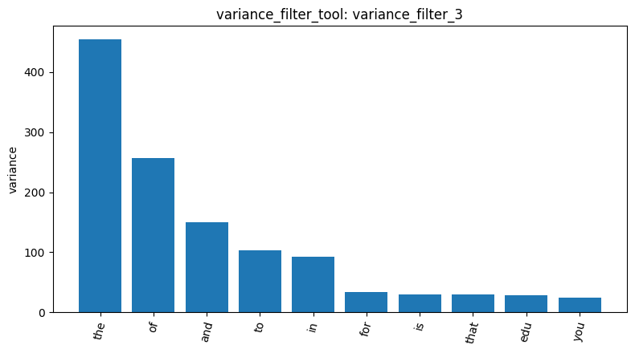
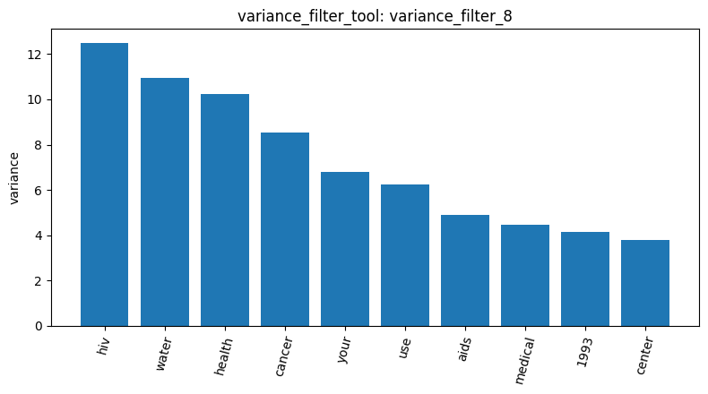
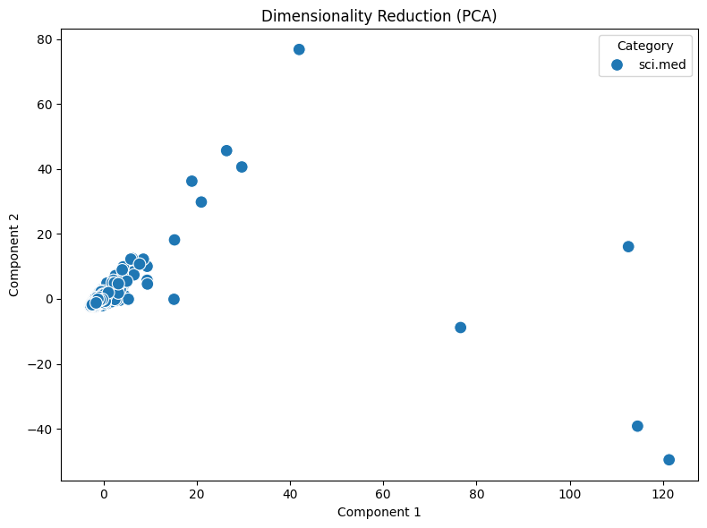
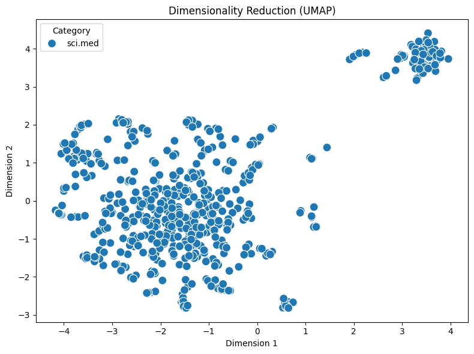

# Agentic Pipeline Analysis Report
 sci_med
**1. Data Loading & Feature Engineering**
I first loaded the `sci.med` dataset and built the Document-Term Matrix (DTM). To eliminate noisy stopwords and rare typos, I applied strict filtering parameters (`max_df=0.3` and `min_df=5`). This successfully reduced the massive feature space down to a highly relevant set of medical terms.

**2. Variance Filtering**
Next, I applied a variance filter to identify the most distinguishing features across the documents. The bar chart confirms the success of the previous filtering step, as the top high-variance terms are now highly specific medical keywords like "hiv", "cancer", and "health" instead of generic words.

**3. Dimensionality Reduction (PCA & UMAP)**
Finally, I visualized the document relationships using PCA and UMAP. While the PCA scatter plot displays a massive central core with a few distinct outliers, the UMAP visualization reveals a much richer internal structure. Notably, UMAP isolated a dense, separate cluster in the upper right, which likely represents a highly specific sub-topic (such as HIV/AIDS discussions) successfully separated from general medical documents.

