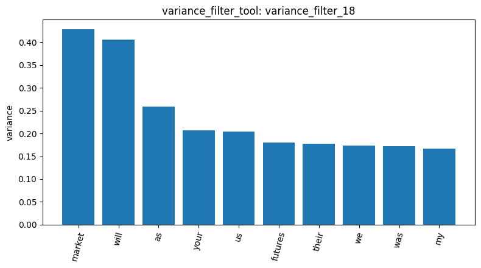
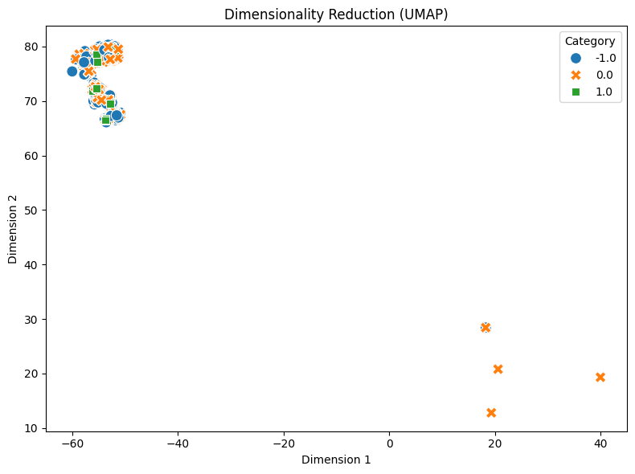
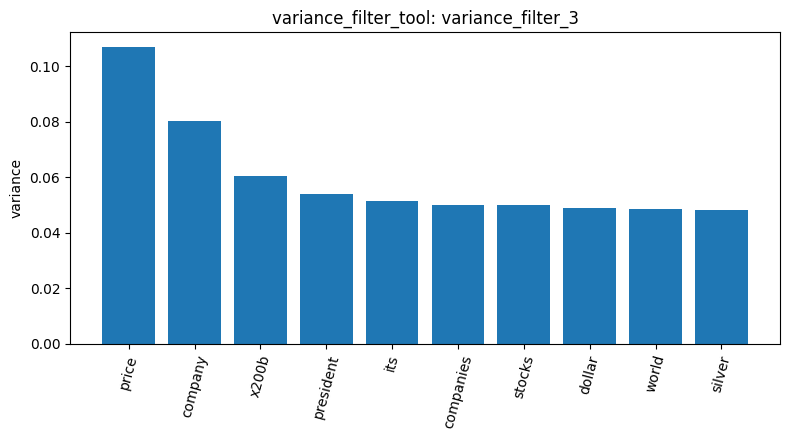
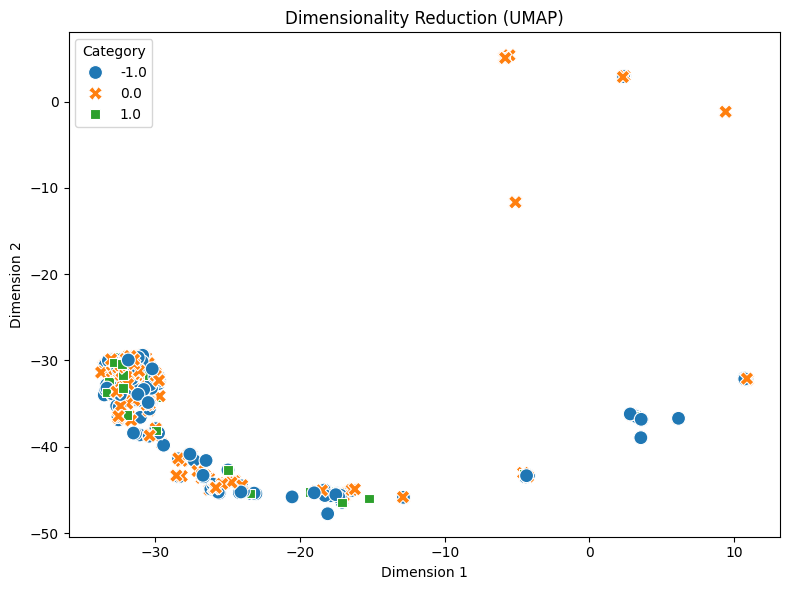

# Your report

STEP 1 :Initial Feature Extraction & Variance Analysis (DTM Filtering)

Description: This step aims to transform unstructured texts from the Reddit stock forum into a Document-Term Matrix (DTM). We first applied max_df=0.1 and min_df=5 for initial filtering, followed by a variance filter (threshold: 0.15) to identify the most representative keywords. The results reveal a typical issue in social media text mining: without applying a stopwords dictionary, features with high variance are mostly dominated by meaningless English pronouns and auxiliary verbs (e.g., will, your, we) rather than substantive financial terms.

STEP 2 : Initial UMAP Dimensionality Reduction

Description: Based on the DTM extracted in Step 1, we utilized the UMAP non-linear dimensionality reduction algorithm to project the high-dimensional data onto a 2D plane. The scatter plot shows that data points representing bullish (1.0), neutral (0.0), and bearish (-1.0) sentiments are highly overlapped and intertwined within the same large cluster. This demonstrates that basic term frequency features, which include many general pronouns, can only group articles discussing "similar topics" but fail to effectively distinguish the subjective sentiments behind them.

STEP 3 :Extreme Parameter Tuning & Feature Purification ("Narrow Gate" Strategy)

Description: To address the issue of pronouns dominating the features, we implemented a "narrow gate" strategy. By drastically lowering the maximum document frequency ceiling (max_df=0.03) to eliminate omnipresent pronouns, raising the minimum appearance threshold (min_df=10) to prevent interference from rare typos, and applying a fine-tuned variance filter (threshold=0.02), this step successfully removed most noise. It yielded a highly purified financial feature matrix (e.g., price, silver, company, buy, sell), significantly enhancing the domain relevance of the extracted features.

STEP 4 :Final UMAP on Purified Features & Conclusion

Description: We fed the highly purified financial features from Step 3 into UMAP for another dimensionality reduction. The results indicate that even when features are entirely focused on stock market terminology, the clusters of different sentiment labels still cannot be perfectly separated in the 2D space. This phenomenon leads to a crucial data mining conclusion: "Both bullish and bearish groups often use the exact same domain vocabulary in their arguments (e.g., both will frequently mention price or silver)." This confirms that a simple Bag-of-Words approach, without the aid of contextual understanding techniques like N-grams or Word Embeddings, faces physical limits in fine-grained sentiment classification.

